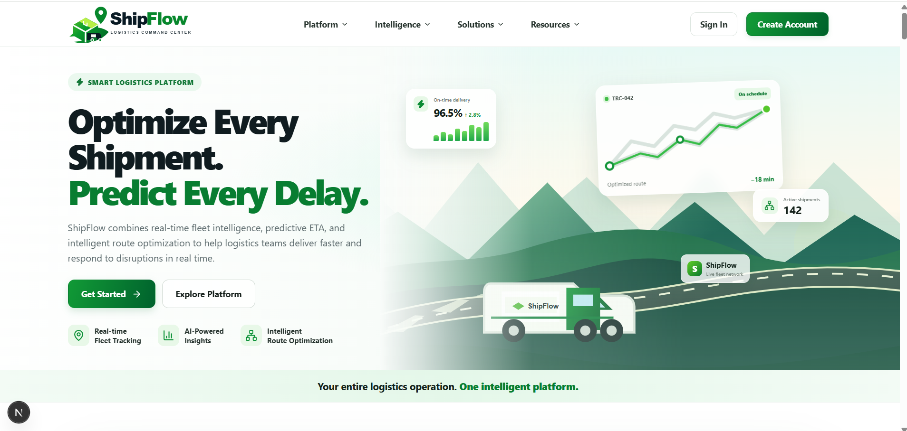
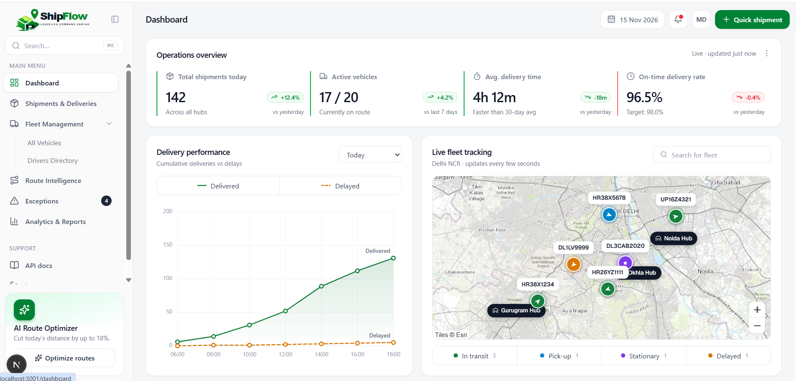
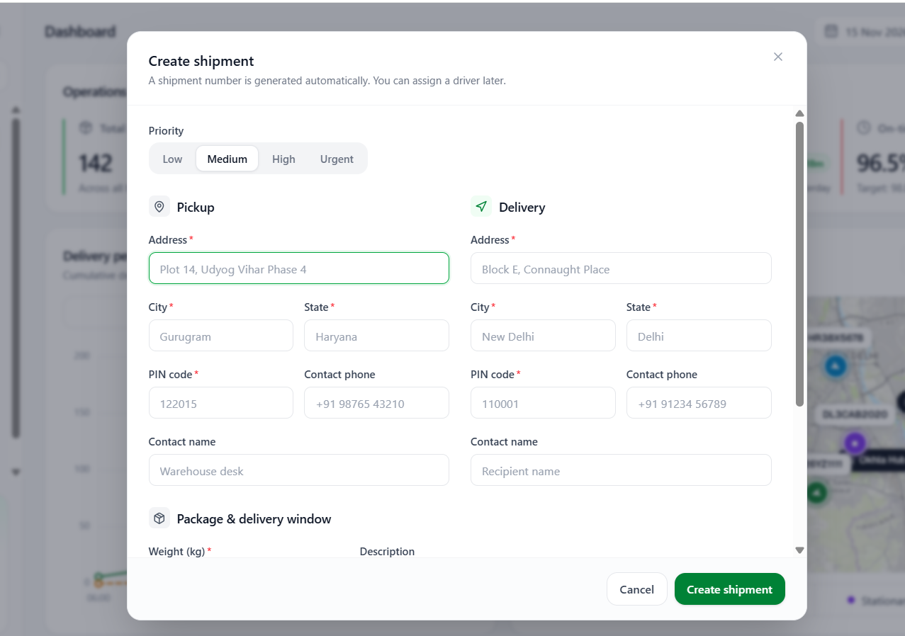

<p align="center">
  
</p>

<h3 align="center">AI-powered logistics & route optimisation platform</h3>

<p align="center">
  Real-time fleet tracking · Predictive ETA · Delay-risk detection · Dynamic route optimisation
</p>

<p align="center">
  
  
  
  
  
  
</p>

---

## Screenshots

### Landing page


### Operations dashboard
KPI overview, delivery-performance chart and a live fleet map with vehicle status filters.



### Create shipment
Shipments are created from anywhere in the dashboard via **Quick shipment**. The server assigns the shipment number and validates every field.



---

## Features

| Area | What it does |
|---|---|
| **Operations dashboard** | KPI strip, delivered-vs-delayed chart with hover tooltips, order-status donut, ML alerts |
| **Live fleet tracking** | Leaflet map with labelled vehicles, direction arrows, hubs, status legend/filters and fleet search; Socket.IO updates |
| **Shipments** | Create shipments (validated DTO, auto-numbered), list with status/priority/risk, detail page with event timeline |
| **Fleet & drivers** | Vehicle load vs capacity, driver directory with ratings and current tasks |
| **Route intelligence** | Current vs optimised plan comparison with distance, time and cost savings |
| **Exceptions center** | Severity-ranked exceptions with recommended actions; acknowledge / resolve workflow |
| **Analytics** | Delivery volume, on-time trend, status distribution, ML model accuracy |
| **Authentication** | Email/password and Google OAuth; httpOnly JWT cookies with refresh-token rotation (hashed, persisted in the database) |
| **ML service** | FastAPI endpoints for ETA prediction and delay-risk scoring |

> Some dashboard widgets (fleet positions, charts, route plans) use seeded demo data so the UI can be explored without live telemetry. Shipments you create are stored in the database and shown alongside the demo rows.

---

## Architecture

```
┌──────────────────────┐      REST + cookies       ┌──────────────────────┐
│  apps/web            │ ────────────────────────▶ │  apps/api            │
│  Next.js 16 (React)  │ ◀──── Socket.IO events ── │  NestJS 10           │
│  Tailwind, Leaflet   │                           │  Prisma ORM, JWT     │
└──────────────────────┘                           └─────────┬────────────┘
                                                             │ HTTP
                                         ┌───────────────────┴──────────┐
                                         │  apps/ml-service             │
                                         │  FastAPI · XGBoost · sklearn │
                                         └──────────────────────────────┘
```

```
ShipFlow_ml/
├── apps/
│   ├── api/           # NestJS API: auth, shipments, drivers, vehicles, events, audit, gateway
│   ├── web/           # Next.js app: landing, auth pages, dashboard
│   └── ml-service/    # FastAPI: /predict/eta, /predict/risk, /health
├── packages/types/    # Shared TypeScript types
├── prisma/            # Schema, seed script
├── docker/            # Dockerfiles
└── docs/screenshots/  # README images
```

---

## Getting started

### Prerequisites
- Node.js **18+** and npm
- Python **3.10+** (only for the ML service)

### 1. Install and configure

```bash
git clone https://github.com/danish975/ShipFlow-ML--based-Logistics-Route-Optimisation-Platform.git
cd ShipFlow-ML--based-Logistics-Route-Optimisation-Platform

npm install
cp .env.example .env        # then set JWT_SECRET / JWT_REFRESH_SECRET
```

Google sign-in is optional. To enable it, set `GOOGLE_CLIENT_ID`, `GOOGLE_CLIENT_SECRET` and `GOOGLE_CALLBACK_URL` in `.env`.

### 2. Set up the database

Local development uses **SQLite** (`prisma/dev.db`), so no database server is needed.

```bash
npm run db:generate   # generate the Prisma client
npm run db:push       # create the tables
npm run db:seed       # optional: demo organisation, users, drivers and vehicles
```

### 3. Run

```bash
npm run dev           # API on http://localhost:3002 and web app via Next.js
npm run dev:ml        # optional: ML service on http://localhost:8000
```

| Service | URL |
|---|---|
| Web app | http://localhost:3000 (Next.js uses the next free port if 3000 is taken) |
| API | http://localhost:3002/api/v1 |
| API docs (Swagger) | http://localhost:3002/api/docs |
| ML service | http://localhost:8000/health |

After seeding you can sign in with `admin@swiftlogistics.in` / `Admin@123`, or create your own account at `/register`.

---

## Useful scripts

| Command | Description |
|---|---|
| `npm run dev` | Start API and web app together |
| `npm run dev:api` / `npm run dev:web` | Start one app |
| `npm run dev:ml` | Start the FastAPI ML service |
| `npm run build` | Build API and web app |
| `npm run db:studio` | Open Prisma Studio |
| `npm run lint` | Lint API and web app |

---

## Tech stack

**Frontend:** Next.js 16, React 19, Tailwind CSS 4, Leaflet, Socket.IO client, lucide-react
**Backend:** NestJS 10, Prisma 5, Passport JWT, class-validator, Swagger, Socket.IO, BullMQ
**Machine learning:** FastAPI, XGBoost, scikit-learn, pandas
**Tooling:** TypeScript, npm workspaces, Docker, GitHub Actions
